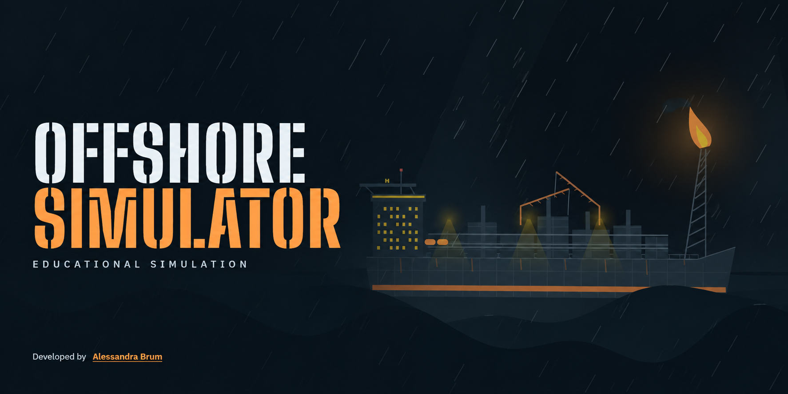

## 🚢 Offshore Simulator { Under construction }  👷
This is the public preview: the intro, the soundtrack, the privacy notice and the phase menu. The phases open as soon as they are ready. Project currently under construction. Keep an eye out for updates!

•  This is an educational offshore operations game, built with HTML, CSS and JavaScript.

• My goal with this project is to improve my technical English skills, increase my web development knowledge in terms of accessibility, responsiveness and user experience and also exercise my generative AI for coding knowledge, as well as learn more about the Oil & Gas industry, considering I have worked for 9 years for technical and legal translations companies and I have always kept in touch with technical documents. I have also had the opportunity to have conversations about this topic with engineers in my private life, being so amazed about it that this subject inspired me to learn about how the oil treatment and oil platforms work.

